<div align="center">


# FinTrack

### Your money, in your currencies, on your pay cycle.

**A personal finance tracker for Android and web. It reads your bank notifications, sorts them with rules you write, and keeps every currency in its own book. Your data stays on your phone, or on a server you run yourself.**

[](https://kotlinlang.org)
[](https://developer.android.com/jetpack/compose)
[](https://react.dev)


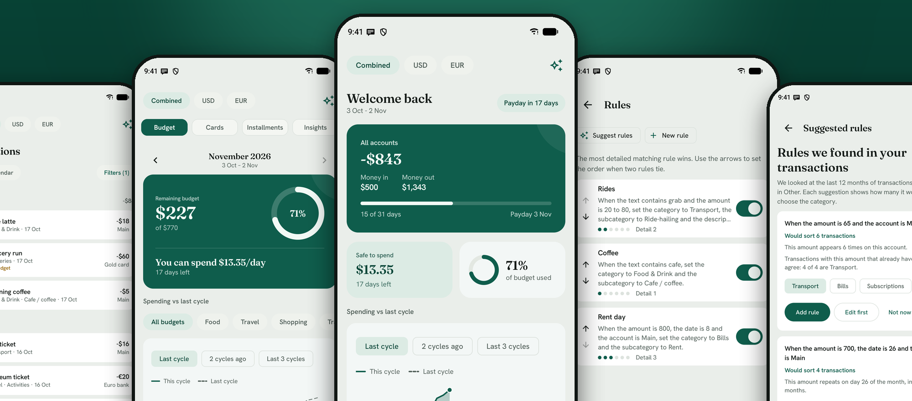

<sub>All data in the screenshots is synthetic demo data.</sub>

[Features](#features) · [Setup](#setup) · [Testing](#testing-and-quality)

</div>

## Why FinTrack

| | |
|---|---|
| **Any currency** | Every account has its own currency, and every currency gets its own book. You choose your home currency and the day your pay cycle starts. |
| **Payments capture themselves** | On Android, FinTrack reads bank notifications as they arrive. Two banks are built in. You can teach it any other bank. |
| **Rules that sort for you** | Sort by a text, an amount, a time, a date, an account or a type. FinTrack can suggest rules from your own transactions. |
| **Bills that post themselves** | Schedule rent, a subscription or a salary. FinTrack adds each one on its day. |
| **Built around your pay cycle** | Budgets, insights and Home follow the month that starts on your payday. |
| **Your data, your choice** | Keep everything on the phone with no server and no account. Or run your own server and share the data with the web app. |

## Features

<table>
  <tr>
    <td align="center" width="25%">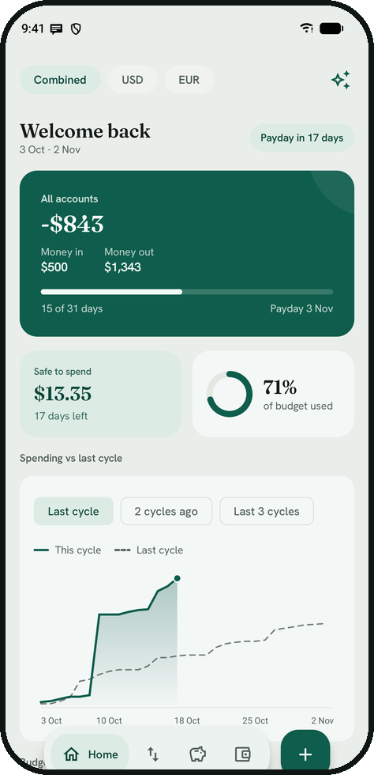<br /><b>Home</b><br /><sub>Cycle overview and spending against past cycles</sub></td>
    <td align="center" width="25%">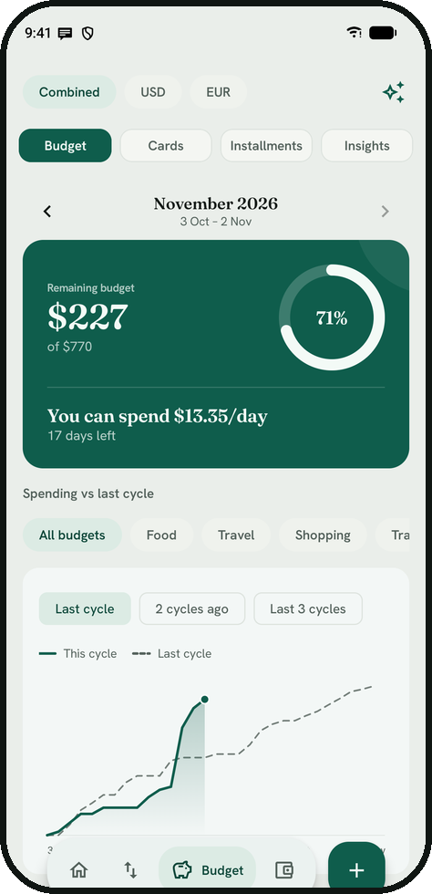<br /><b>Budget</b><br /><sub>What is left, and a safe amount per day</sub></td>
    <td align="center" width="25%">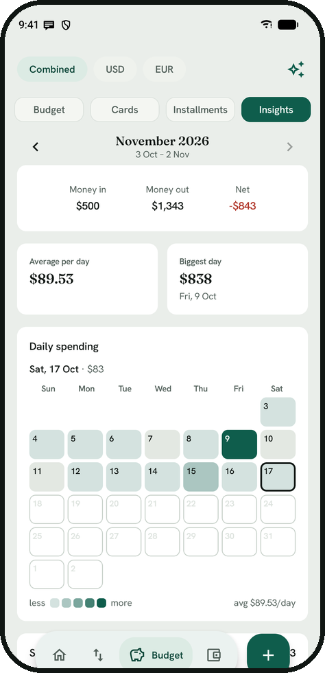<br /><b>Insights</b><br /><sub>Heatmap, categories, six-month trend</sub></td>
    <td align="center" width="25%">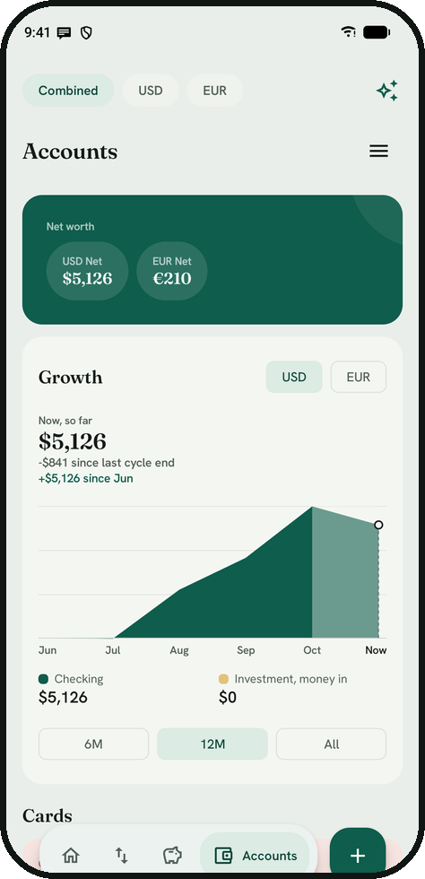<br /><b>Accounts</b><br /><sub>Balances, net worth per currency, growth</sub></td>
  </tr>
  <tr>
    <td align="center" width="25%">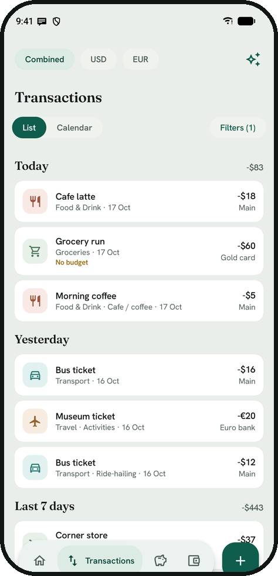<br /><b>Transactions</b><br /><sub>Search, filters, calendar view</sub></td>
    <td align="center" width="25%">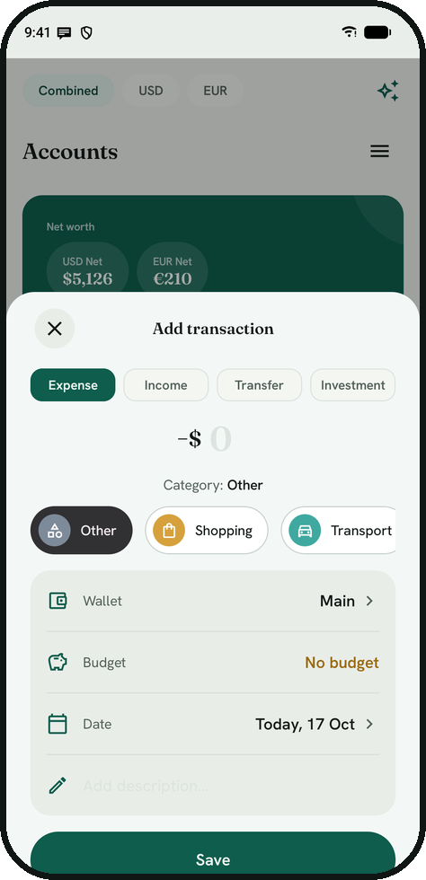<br /><b>Add</b><br /><sub>Expense, income, transfer, investment</sub></td>
    <td align="center" width="25%">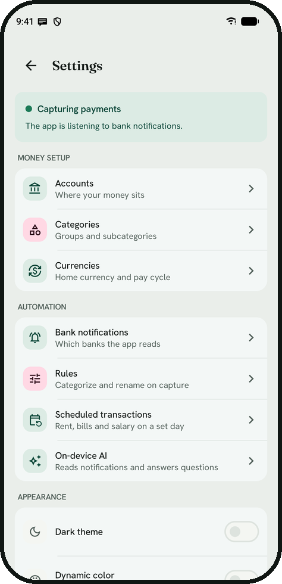<br /><b>Settings</b><br /><sub>Capture status and every setup page</sub></td>
    <td></td>
  </tr>
</table>

- **Books.** One switch above every tab. Combined shows everything in your home currency. One currency shows only its accounts.
- **Setup wizard.** Where to keep the data, then home currency, pay cycle day and accounts, one question per page. Exchange rates are learned from your own transfers.
- **Offline mode and backup.** With the data on the phone, FinTrack works without a server. Settings > Backup exports everything to one JSON file. On a new phone, setup restores that file. You choose the storage once, in setup.
- **Budgets.** Flexible monthly limits and fixed bills, per category or subcategory. Create and edit them in Settings > Budgets. The spending chart compares this cycle with the last 1, 2 or 3 cycles.
- **Cards and installments.** Statement balance, minimum payment and due date. Installment plans link to card payments. Add and delete plans in Settings > Installment plans.
- **Ask about your spending.** An optional on-device model answers questions such as "how much did I spend on Food in the first week of August". The model picks a tool and the app counts, so the amounts are exact.
- **Growth and opening balance.** Account balance at the end of each pay cycle, with an opening balance per account.
- **Web app.** Transactions, balances, add, insights, installments, card debt, budget, calendar, accounts and categories.

### Rules that sort for you

A rule sorts a transaction by a text, an amount, a time, a date (a day or a range), an account or a type. The most detailed matching rule wins. Rules are made in three guided steps with a Try it box. FinTrack suggests rules from your transactions that are still in Other. You can apply a rule to the last 30 days, 3 months or 12 months and undo it. With a server, rules sync through it. Details: [`docs/custom-rules.md`](docs/custom-rules.md).

<p align="center">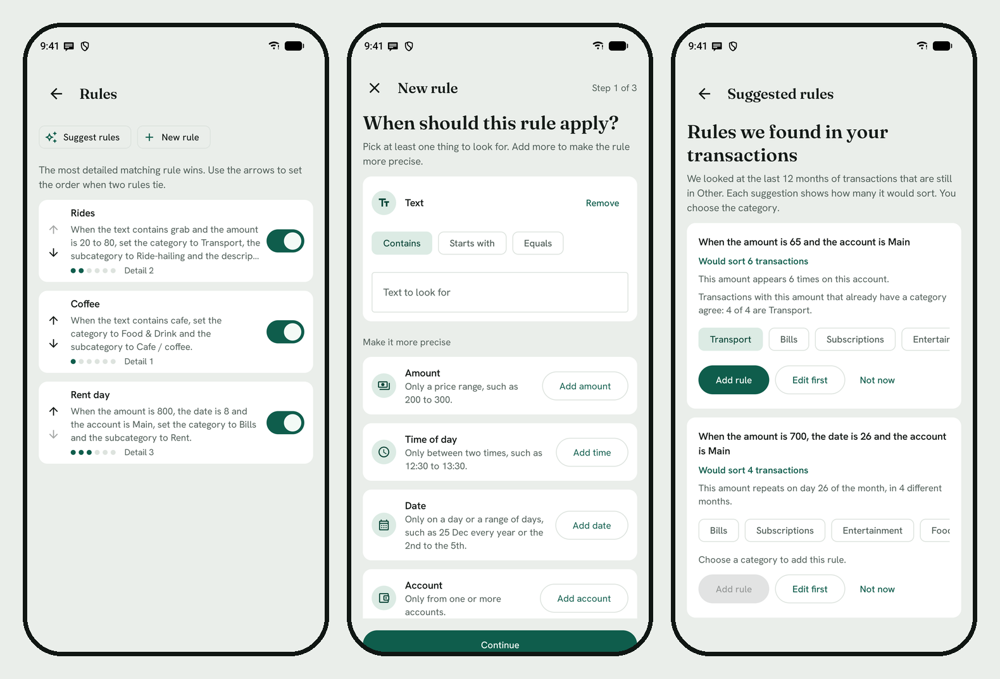</p>

### Scheduled transactions

Pick an idea, say how much, then say when in one sentence, such as "every month on day 1". A schedule repeats monthly, weekly or every N days and can end on a date. A background job adds each due transaction, including dates missed while the phone was off. Your rules run on each one. A schedule can pay a step of an installment plan. Turning on auto-post shows a warning, because your bank may also send a notification for the same payment. Schedules stay on the phone for now.

<p align="center">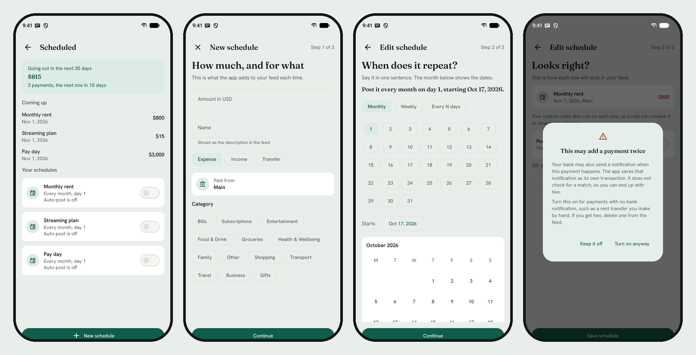</p>

### Automatic capture

- **Supported banks.** BCA (myBCA) and Bangkok Bank (Bualuang) have built-in patterns. For any other bank, add your own pattern in Settings > Bank notifications > Your own banks: paste one notification and tap the amount and the shop. The optional on-device AI model reads the rest.
- **Home notice.** A small card on Home tells you about transactions the app added by itself. Dismiss it, or tap it to open Transactions.

Capture reads the notification text on the device, not email or SMS. It needs Notification access. To add a built-in pattern in code, add an entry to `KnownBank` and a pattern in `NotificationParser`.

<p align="center">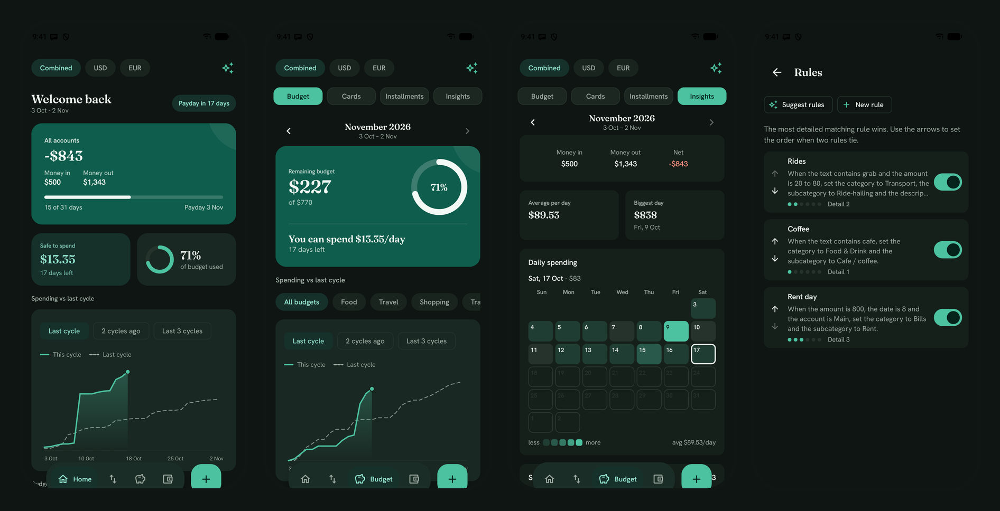</p>

## Tech stack

| Layer | Technology |
|---|---|
| Android | Jetpack Compose, Material 3, MVVM, Hilt |
| Storage | Room (transactions, accounts, categories) and DataStore (settings, rules, schedules) |
| Networking | Retrofit and OkHttp |
| On-device AI | LiteRT-LM, optional model download |
| Web | React 19 and Vite |
| Testing | JUnit, MockK, Vitest, Maestro end-to-end flows |
| Backend | Optional. [fintrack-server](https://github.com/rezyfr/fintrack-server): a REST API on PostgreSQL that you run yourself |

## Setup

FinTrack keeps your data in one of two places. You choose the place in the app's setup, the first time the app opens.

| Mode | Where your data is | What you need |
|---|---|---|
| **A. On this phone** | In the app, on your phone only. No server and no account. | Android Studio and an Android phone or emulator |
| **B. On your own server** | On a FinTrack server that you run. The web app needs this mode. | The same, plus a FinTrack server with an HTTPS address |

The mode stays fixed after setup. To change it, see [Change the mode](#change-the-mode).

### 1. Install the Android app

Both modes start here.

1. Install [Android Studio](https://developer.android.com/studio). It includes JDK 17. In its SDK Manager, install Android SDK 35.
2. Get the code.

   ```bash
   git clone https://github.com/rezyfr/fintrack-android.git
   ```

3. In Android Studio, open the `fintrack-android` folder. Wait until the Gradle sync ends.
4. Connect your phone with a USB cable and turn on USB debugging in its developer options. You can use an emulator instead.
5. Click **Run**. Android Studio installs FinTrack and opens it.

### 2A. Keep the data on the phone

1. In FinTrack, tap **Let us go**.
2. Choose **On this phone**, then tap **Continue**.
3. Answer the next pages: your home currency, the day your pay cycle starts, and your accounts. Then tap **Open FinTrack**.

Android does not back up the data of this app. Export a backup now and then:

- **Export.** Open Settings, then tap **Export a backup** in the Backup group. Save the file outside the phone, for example on a cloud drive.
- **Restore on a new phone.** In setup, choose **On this phone**, then tap **Restore a backup file** and pick the file.

### 2B. Keep the data on your own server

1. **Run the server.** The code and the full guide are in [fintrack-server](https://github.com/rezyfr/fintrack-server). The server needs PostgreSQL and a token that you choose. Docker Compose starts both on one computer. Keep the token. You type it in step 4.
2. **Give the server an HTTPS address.** The app connects only to an address that starts with `https://`. The server does not serve HTTPS by itself. Two ways to get an HTTPS address:
   - Deploy the server to Google Cloud Run. Cloud Run gives it an address such as `https://fintrack-api-123.asia-southeast1.run.app`.
   - Run the server on your own computer behind a reverse proxy that has a certificate.

   To check the address, open `https://<your address>/health` in a browser. It must show `{"status":"ok"}`.
3. In FinTrack, tap **Let us go**. Choose **On my own server**, then tap **Continue**.
4. Type the server address and the token. Tap **Test the connection**.
5. When the test passes, tap **Continue**. If the server already has accounts, tap **Open FinTrack**, and you are done. If it has none, answer the pages for your currency, pay cycle and accounts.

If the test fails, the message tells you what to fix.

| Message starts with | What to do |
|---|---|
| FinTrack needs an https:// address | Use the HTTPS address from step 2. |
| Nothing answered at this address | Check the address. Check that the server runs. |
| The server refused the token | Type the token that the server uses. |
| Something answered at this address, but it is not a FinTrack server | Check that the address leads to the FinTrack server. |

**Optional: build a server into the app.** Copy `local.properties.example` to `local.properties`. Set `API_BASE_URL` with no trailing slash, and `API_TOKEN`. Setup then fills in both fields for you.

### 3. Turn on automatic capture

FinTrack reads your bank notifications to add payments by itself. It works in both modes.

1. Open the Accounts tab. It has a wallet icon. Tap the menu button at the top to open Settings.
2. The card at the top says **Not capturing payments**. Tap it.
3. Android opens its notification access page. Allow FinTrack.

### Web app

The web app needs mode B. It uses the same server address and token.

```bash
cd web
cp .env.example .env   # set VITE_API_BASE_URL to the HTTPS address and VITE_API_TOKEN to the token
npm install
npm run dev
```

You need Node.js 18 or later. The web build contains the token, so host it where only you can reach it, for example behind a VPN or a password page.

### Change the mode

The app has no switch for the mode. To change it, you clear the app data and set up the app again.

1. In mode A, export a backup first. Clearing the app data deletes everything on the phone.
2. In Android Settings, open the app info of FinTrack. Then open its storage page and tap **Clear storage**. The names differ a little between phones.
3. Open FinTrack. Setup starts again. Choose the other mode.

A backup file restores into mode A only. FinTrack cannot copy the data of the phone to a server.

### Release build

`./gradlew :app:assembleRelease` builds an unsigned APK with R8 on. Sign it with your own keystore (`zipalign`, then `apksigner sign`). Keep `app/build/outputs/mapping/release/mapping.txt` of every build you share, because a release crash trace is unreadable without it. A class that Gson reads by field name needs a keep rule in `app/proguard-rules.pro`.

## Testing and quality

| What | How |
|---|---|
| Android unit tests | `./gradlew :app:testDebugUnitTest` |
| Android instrumented tests | The DAO queries on a real SQLite, and a check of the Hilt graph. Start an emulator, then run `./gradlew :app:connectedDebugAndroidTest`. |
| Web tests | `cd web && npm test` |
| End-to-end flows | More than 120 [Maestro](https://maestro.mobile.dev) flows in `.maestro/` against a local fake server, so no real data. Run `bash .maestro/scripts/run_all.sh`. |
| Gates | `bash governance/check_all.sh` |

The flow list is in [`docs/e2e-maestro-cases.md`](docs/e2e-maestro-cases.md). The screenshots come from the same fake server (see `.maestro/screenshots/README.md`).

## Contributing

Run the gates before you open a pull request: `bash governance/check_all.sh`. They check the architecture, hardcoded colors, text sizes and strings, the Room migration chain, the web API boundary, that app code does not name a specific currency, bank or city, that no secrets are committed, the build, and Kotlin formatting. CI runs the same gates. Fix formatting with `./gradlew :app:spotlessApply`. The architecture rules, with pass and fail examples, are in [`governance/docs/conventions.md`](governance/docs/conventions.md).

> [!TIP]
> Using an AI coding agent? Read `CLAUDE.md` first. The rule book for each gate is in `governance/docs/conventions.md`.

## License

FinTrack is released under the [MIT License](LICENSE).
